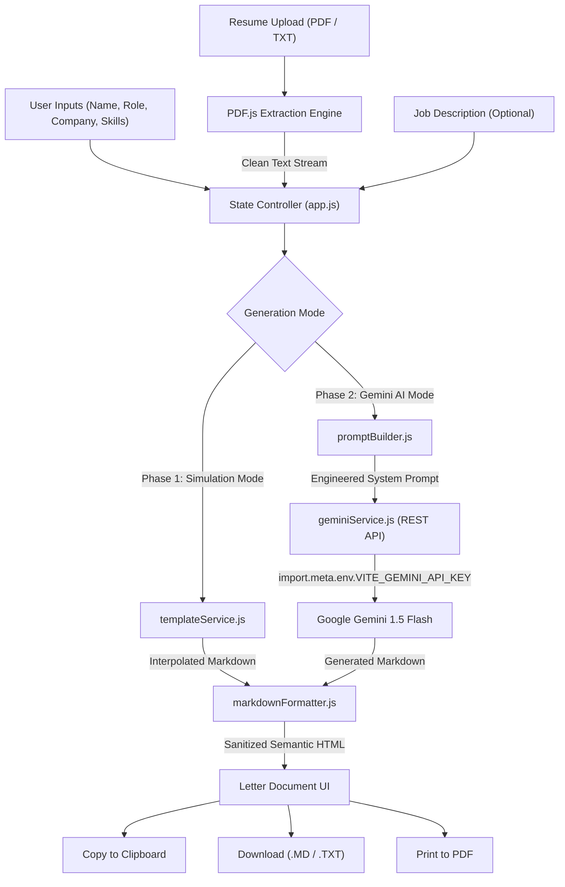

# Sprint 04: AI Cover Letter Generator — Engineering Specification

## 📌 Executive Overview
- **Project**: AI Cover Letter Generator (SaaS AI Wrapper Utility)
- **Role**: Junior Full Stack Developer / AI Engineering Trainee
- **Module**: Week 4 — AI Engineering & SaaS Architecture
- **Tech Stack**: Vanilla JavaScript (ES6+ Modules), HTML5, CSS3 Custom Properties, Google Gemini 1.5 Flash API, Mozilla PDF.js, Vite build tooling.
- **Security Standard**: Strict environment variable isolation (`.env` via `VITE_GEMINI_API_KEY`, verified `.gitignore` exclusion).

---

## 🎯 Engineering Objectives & Deliverable Matrix

### Phase 1: Base MVP & Data Simulation (Mandatory Deliverables — P0)
*Fulfills the baseline functional requirement for grading eligibility.*

| Requirement | Implementation Detail | Status |
| :--- | :--- | :---: |
| **UI Architecture** | Responsive, accessible form capturing: `Candidate Name`, `Target Company`, `Job Role`, and `Key Skills`. | Complete ✅ |
| **State Logic** | Synchronous and asynchronous state capture via `handleFormSubmit` and input listeners. | Complete ✅ |
| **Data Simulation** | Controller function `simulateCoverLetterGeneration()` interpolating state variables into deterministic, realistic cover letter templates without making external API calls. | Complete ✅ |
| **UX Polish** | Dedicated rendered output component with a one-click **"Copy to Clipboard"** utility supporting both modern `navigator.clipboard` and legacy fallback with visual confirmation toast. | Complete ✅ |

---

### Phase 2: LLM Integration & Security (Priority 1 Features — P1)
*Demonstrates secure API key management and programmatic Prompt Engineering.*

| Requirement | Implementation Detail | Status |
| :--- | :--- | :---: |
| **API Integration** | Connected to **Google Gemini REST API** (`gemini-1.5-flash`), utilizing official HTTP `generateContent` payloads with configurable temperature and safety parameters. | Complete ✅ |
| **Prompt Engineering** | Programmatic prompt constructor (`buildCoverLetterPrompt()`) dynamically injecting candidate parameters, company background, tone, and length directives. | Complete ✅ |
| **Security Architecture** | Environment variables stored in `.env` (`VITE_GEMINI_API_KEY`). `.env` is rigorously verified in `.gitignore` to prevent any secret exposure on public GitHub repositories. | Complete ✅ |
| **State Management** | Multi-phase animated **"Generating..."** state handling 2–5 second LLM latency with visual progress bar, status notifications, and user abort/cancel capability. | Complete ✅ |

---

### Phase 3: SaaS Level Capabilities (Priority 2 Features — P2)
*Engineers aiming for top engineering ratings.*

| Requirement | Implementation Detail | Status |
| :--- | :--- | :---: |
| **File Parsing Dropzone** | Interactive drag-and-drop zone and file picker accepting PDF and TXT resumes up to 10MB. | Complete ✅ |
| **Client-Side Text Extraction** | Integrated Mozilla `pdfjs-dist` to extract plain text streams from multi-page PDFs directly in the browser with memory-safe buffers. | Complete ✅ |
| **Dynamic Personalization** | Appends parsed resume text and job description requirements into the Gemini prompt payload to yield tailored, contextualized cover letters. | Complete ✅ |
| **Semantic Markdown Parser** | Custom `parseMarkdownToHtml()` transforming LLM markdown into formatted HTML paragraphs (`<p class="cl-paragraph">`), bullet lists, and bold headings rather than a single monolithic block. | Complete ✅ |
| **Export & Editing Suite** | Dual-mode raw Markdown editor vs rendered preview, download as `.txt` and `.md`, and browser-optimized Print/PDF styling. | Complete ✅ |

---

## 🏗️ Architecture & Data Flow



---

## 🔒 Security Compliance Protocol

1. **Environment Isolation**:
   - The `.env` file contains runtime secrets:
     ```env
     VITE_GEMINI_API_KEY=AIzaSy...
     ```
   - `.gitignore` contains strict exclusion rules:
     ```gitignore
     .env
     .env.local
     .env.*.local
     *.env
     ```
2. **CI Check Pre-Flight**:
   - Run `git status --ignored` to verify `.env` is ignored by Git before pushing.
   - Run `git log -p` to verify no past commits contain exposed API keys.

---

## 🚀 Execution & Local Development

### Option A: Modern Vite Dev Server (Recommended)
```bash
# 1. Install dev dependencies
npm install

# 2. Configure environment file
cp .env.example .env
# Open .env and add your Gemini API Key

# 3. Start local development server
npm run dev
```

### Option B: Direct Live Server / Browser Execution
1. Open the project root in VS Code.
2. Launch `index.html` with **Live Server** (port 5500) or open directly in Chrome/Edge.
3. Click the **Settings (Gear Icon)** in the navbar to paste a session API key into local storage, or toggle **"Simulation (MVP)"** mode to run 100% offline.

---

## 🎥 QA Video Submission Protocol
- **Max Duration**: 3 Minutes.
- **Narrative Requirement**: Technical voiceover explaining architecture, prompt engineering, security protocol, and live demo.
- **Demo Script**: Follow the structured script provided in `Prompts.md`.
